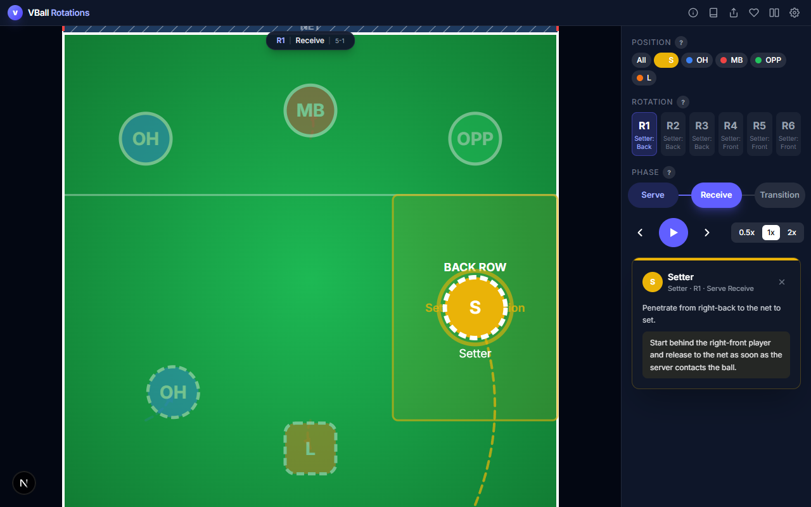
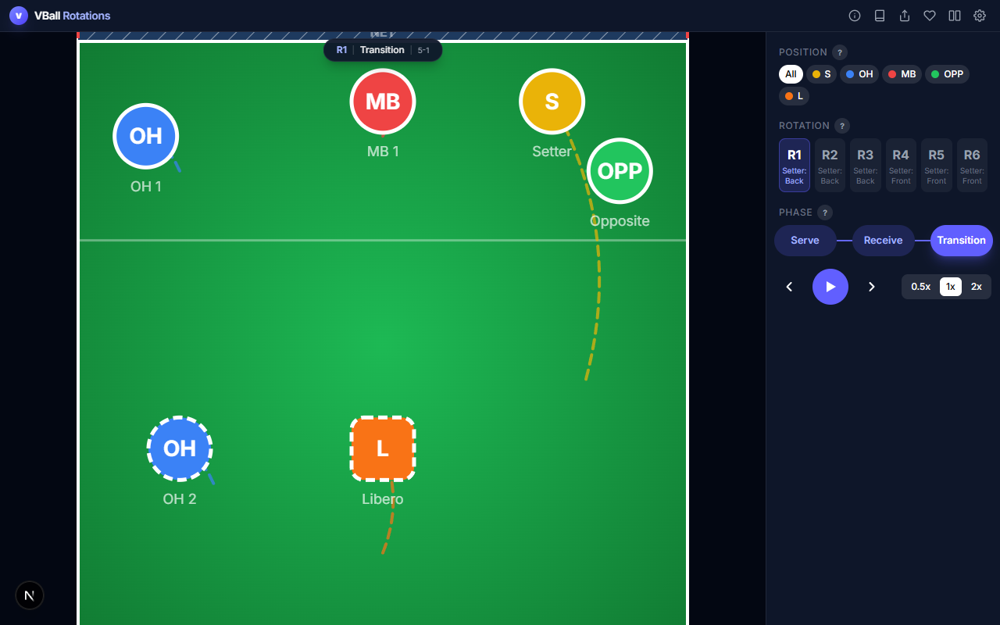
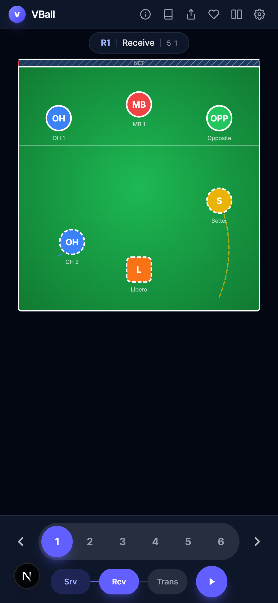
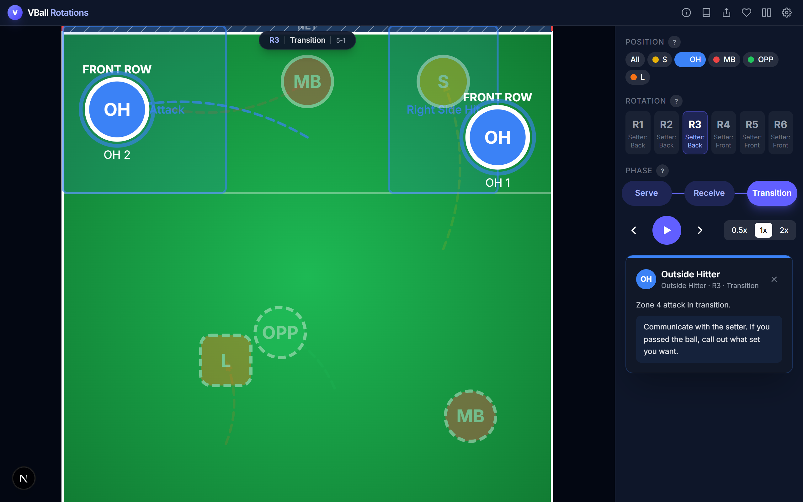
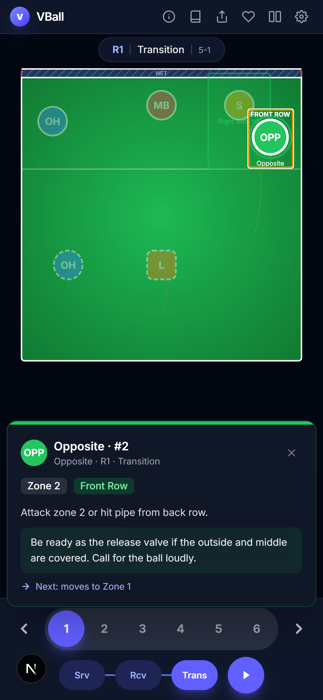
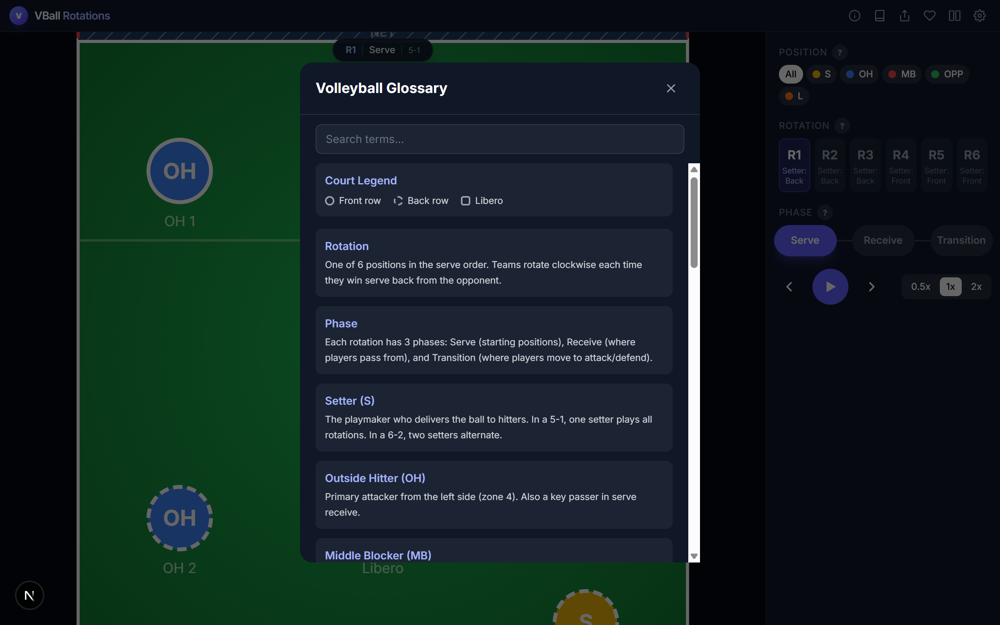
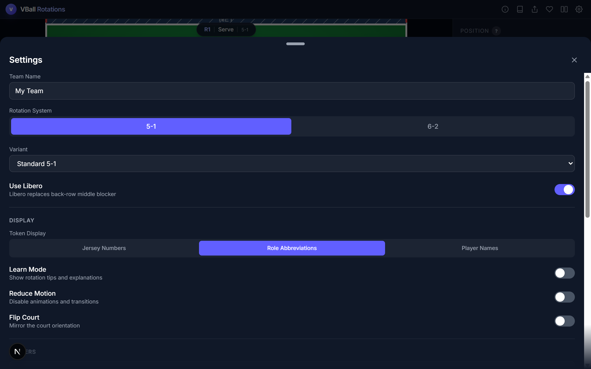

<div align="center">

# VBall Rotations

### Interactive Volleyball Rotation Tool

Visualize 5-1 and 6-2 systems with animated court diagrams,<br>player movements, and phase breakdowns.

**Free. Open-source. Mobile-friendly.**

[**Try it live**](https://vball.mohammadhameed.dev) | [Report a Bug](https://github.com/MoeHameed/vball-rotations/issues/new) | [Support Development](https://donate.stripe.com/9B68wOgRb8YbdNNdBH67S04)


</div>

---

<div align="center">

<a href="https://vball.mohammadhameed.dev">
  <picture>
    
  </picture>
</a>

<br>

<sup>R1 Receive phase — setter penetration highlighted with zone overlay, movement arrows, and player info panel</sup>

</div>

---

## What is this?

VBall Rotations helps players, coaches, and fans understand volleyball rotation systems through interactive court visualizations. Instead of static diagrams, you get animated transitions between phases, clickable player tokens with role-specific info, and the ability to customize your own team lineup.

<div align="center">
<table>
<tr>
<td width="60%">

<br><sup>Transition phase — movement arrows show where players shift from receive positions</sup>
</td>
<td width="40%">

<br><sup>Mobile — full court with compact controls</sup>
</td>
</tr>
</table>
</div>

---

## Features

### Interactive Court with Zone Overlays

Click any player or filter by position to see their zone of responsibility, movement arrows, and coaching tips. Each rotation and phase has specific positional data.

<div align="center">

<br><sup>OH filter active — outside attack and right-side hit zones with positional tips in the sidebar</sup>
</div>

<br>

### Player Info & Coaching Tips

Tap any player token to see their role, zone, row assignment, coaching tips, and where they move next. Available in every rotation and phase.

<div align="center">

<br><sup>Mobile player info — zone, row, tips, and next movement</sup>
</div>

<br>

### Volleyball Glossary

Searchable reference for volleyball terms, court legend, rotation systems, and all 5-1 variants explained.

<div align="center">

</div>

<br>

### Team Customization & Settings

Customize player names, jersey numbers, and roles. Switch between 5-1 and 6-2 systems, choose rotation variants (Standard, Spread, Slide-Heavy, Reverse), toggle libero, and adjust display preferences.

<div align="center">

</div>

---

### All Features

**Rotation Systems**
- 5-1 System with 4 variants: Standard, Spread, Slide-Heavy, Reverse
- 6-2 System with full rotation support
- All 6 rotations with 3 phases each (Serve, Receive, Transition)
- Overlap-legal serve positions

**Interactive Court**
- SVG court with animated player tokens
- Movement arrows and ghost trails between phases
- Zone overlays showing area of responsibility
- Role-based position filtering

**Learning Tools**
- Clickable player tokens with role-specific tips
- Searchable volleyball glossary
- Contextual help popovers
- Learn mode with phase descriptions

**Sharing & Customization**
- Shareable URLs with full team config (QR code)
- Editable player names, numbers, roles
- Multiple display modes (jersey, role abbreviation, name)
- Court flip, reduce motion, libero toggle

**Mobile-First**
- Responsive design with dedicated mobile controls
- Swipe gestures for navigation
- Touch-friendly bottom sheet settings
- Safe area support

**Keyboard Shortcuts**

| Key | Action |
|-----|--------|
| `Arrow Left` / `Arrow Right` | Step backward / forward |
| `Space` | Play / Pause |
| `1` - `6` | Jump to rotation |
| `Escape` | Close modal or clear focus |

---

## Getting Started

### Prerequisites

- [Node.js](https://nodejs.org/) 18+
- npm

### Install & Run

```bash
git clone https://github.com/MoeHameed/vball-rotations.git
cd vball-rotations
npm install
npm run dev
```

Open [http://localhost:3000](http://localhost:3000).

### Build for Production

```bash
npm run build
npm start
```

---

## Tech Stack

| Layer | Technology |
|-------|-----------|
| Framework | [Next.js 16](https://nextjs.org/) (App Router) |
| Language | [TypeScript 5](https://www.typescriptlang.org/) (strict mode) |
| Styling | [Tailwind CSS 4](https://tailwindcss.com/) |
| Animation | [Framer Motion 12](https://www.framer.com/motion/) |
| Sharing | [qrcode.react](https://github.com/zpao/qrcode.react) + [lz-string](https://github.com/pieroxy/lz-string) |

---

## Project Structure

```
src/
├── app/                    # Next.js App Router
│   ├── page.tsx            # Main application page
│   ├── layout.tsx          # Root layout with metadata & SEO
│   └── globals.css         # Tailwind + custom styles
├── components/
│   ├── compare/            # Side-by-side rotation comparison
│   ├── controls/           # Playback, rotation, phase controls
│   ├── court/              # Court SVG, player tokens, zones, arrows
│   ├── help/               # Glossary, help popovers, support modal
│   ├── info/               # Player info sheet, position tips
│   ├── onboarding/         # Welcome screen
│   ├── setup/              # Settings drawer, player cards
│   └── sharing/            # Share button + QR modal
├── data/
│   ├── rotations-5-1.ts    # 5-1 rotation positions & zones
│   ├── rotations-5-1-*.ts  # Spread, Slide, Reverse variants
│   ├── rotations-6-2.ts    # 6-2 rotation positions & zones
│   ├── position-info.ts    # Role-specific tips per rotation
│   └── variants.ts         # Variant metadata
├── hooks/                  # Custom React hooks
│   ├── useRotation.ts      # Rotation state management
│   ├── useTeam.ts          # Team/player state
│   ├── useAnimation.ts     # Playback animation
│   ├── usePreferences.ts   # User preferences (localStorage)
│   └── useUrlState.ts      # URL sharing/persistence
└── lib/
    ├── rotationEngine.ts   # Core engine: maps players to positions
    ├── constants.ts        # Role colors, default players
    ├── courtMath.ts        # Court coordinate conversions
    └── types.ts            # TypeScript interfaces
```

---

## Contributing

Contributions are welcome. If you find an inaccurate rotation position, a UI bug, or want to add a new feature:

1. Fork the repo
2. Create a feature branch (`git checkout -b fix/rotation-3-receive`)
3. Make your changes
4. Run `npm run build` to verify
5. Open a pull request

For rotation data changes, please verify positions against official volleyball overlap rules.

---

## Support

If you find this tool useful, consider supporting development:

<div align="center">

[](https://donate.stripe.com/9B68wOgRb8YbdNNdBH67S04)

</div>

**Found a bug?** [Open an issue](https://github.com/MoeHameed/vball-rotations/issues/new)
**Questions?** [hello@mohammadhameed.dev](mailto:hello@mohammadhameed.dev)

---

## License

[MIT](LICENSE) — use it, fork it, learn from it.
